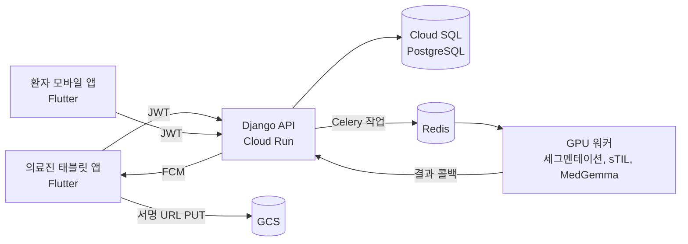

# 의료영상 분석 플랫폼 — 의료진 태블릿 앱

> 팀 프로젝트의 공개 사본입니다. 원본은 `medical-ai-group-3/cdss_ai_platform`(비공개)입니다.
> 커밋 기록과 작성자는 원본과 같습니다. 원본 기록에서 Firebase 설정 파일과 팀원 개인 메일을 지우고, 서버 주소 일부를 가렸습니다.

병리 이미지의 sTIL 분석을 의료진이 태블릿에서 요청하고 결과를 확인하는 플랫폼입니다.
의료진 태블릿 앱, 환자 모바일 앱, Django API, GPU 분석 워커로 이루어집니다.

| 항목 | 내용 |
|---|---|
| 기간 | 2026.08 |
| 인원 | 5명 |
| 내 역할 | 의료진 태블릿 앱(`tablet/`) 전체, 앱 공유 패키지(`shared/`) |

## 핵심 가치

1. **업로드부터 결과까지 한 화면 흐름:** 환자를 고르고, 이미지를 올리고, 분석 진행과 결과를 태블릿에서 봅니다.
2. **의료 앱에 맞는 토큰 처리:** 토큰을 암호화 저장소에 둡니다. 만료되면 자동으로 갱신하고, 동시에 실패한 요청도 갱신은 1번만 합니다.
3. **판정 유보 확정:** AI가 판정을 유보한 결과는 의료진이 확정합니다. 확정 기록은 지우지 않고 쌓입니다.

## 내가 만든 것

| 한 일 | 내용 |
|---|---|
| 화면 9개와 라우팅 (go_router) | 로그인, 배치 목록과 상세(마스터-디테일), 판독 결과, 새 분석, QR 환자 확인, 알림, 채팅 |
| 상태 관리 (Riverpod) | 인증, 업로드, 배치 목록, 알림, 환자 검색 provider |
| API 클라이언트 (dio) | JWT Bearer 인증, 401 응답 때 토큰 자동 갱신(single-flight), Cloud Run 콜드 스타트를 고려한 타임아웃(연결 30초, 수신 60초) |
| 이미지 업로드 | 배치 생성 → 서명 URL 받기 → GCS에 직접 PUT → 분석 시작 |
| 푸시 알림 (FCM) | 로그인 뒤 기기 토큰 등록, 분석 완료와 판정 유보 알림 |
| 공유 패키지 `shared/` | 테마(라이트, 다크), API 모델, 인증 로직을 환자 앱과 같이 씀 |

## 구조

| 구성 요소 | 내용 |
|---|---|
| `tablet/` | 의료진 앱: 분석 요청, 결과 확인, 판정 유보 확정, 결과 공유 |
| `mobile/` | 환자 앱: 예약, 복약 관리, 진료 내역, QR 발급 |
| `shared/` | 두 앱이 같이 쓰는 테마, 모델, 인증 |
| `backend/` | Django REST API: 계정, 환자, 진료, 분석, 채팅 토큰 |
| `worker/` | Celery 워커: 세그멘테이션(Mosec), sTIL과 Conformal 계산, MedGemma 보고서 |
| `react/` | 웹 화면 |

## 기술 스펙

| 영역 | 기술 |
|---|---|
| 앱 | Flutter (Dart ^3.12.2), hooks_riverpod 3.4, go_router 17.3, dio 5.11, flutter_secure_storage 10.3, mobile_scanner 7.4 |
| Firebase | firebase_core, firebase_messaging (FCM), Firestore (채팅) |
| 백엔드 | Django, DRF, SimpleJWT, Celery, Redis |
| GCP | Cloud Run, Cloud SQL, Cloud Storage |

## 분석 결과 데이터

워커는 결과를 2단계로 알립니다. 앱은 단계마다 화면을 바꿉니다.

| 단계 | 상태 | 내용 |
|---|---|---|
| 1 | `stil_done` | sTIL 값, 예측 구간(lower, upper), 판정 유보 여부, 조직 구성 비율, 마스크 이미지 |
| 2 | `succeeded` | MedGemma 판독 보고서 |
| 실패 | `failed` | 오류 문구 |

## 실행

1. 공유 패키지와 앱 패키지를 받습니다: `cd tablet && flutter pub get`
2. Firebase 설정 파일을 직접 만듭니다. 이 저장소에는 없습니다. `flutterfire configure`로 내 Firebase 프로젝트에 연결합니다.
3. 앱을 실행합니다: `flutter run --dart-define=API_BASE_URL=<API 주소>`
4. 백엔드는 `backend/`에서 실행합니다: `pip install -r ../requirements.txt && python manage.py migrate && python manage.py runserver`

- 분석 워커는 GPU와 모델 가중치가 필요합니다. 백엔드의 `USE_MOCK_INFERENCE=true`(기본값)로 워커 없이 화면을 시험할 수 있습니다.

## 팀

| 폴더 | 담당 |
|---|---|
| `tablet/`, `shared/` | **Yun-sooyong** |
| `mobile/` | jungeun |
| `backend/` | da-hee-da |
| `worker/` | spgummo0905, da-hee-da |
| `react/` | ilunee |
